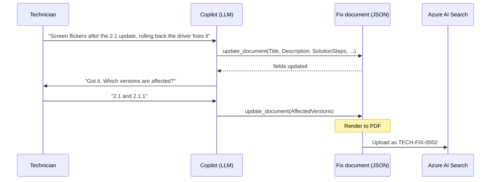

<p align="center">
  
  
  
</p>

**FFtemplate** is the building blocks for a knowledge base copilot. A technician describes a problem and its fix in plain conversation. The model fills in a structured fix document as they talk, and the finished document is rendered to PDF and pushed into a search index where the next technician can find it.

The point is to make documentation a by-product of the conversation, so nobody has to fill in a form.

## How it works



1. **One tool.** The model is given a single function, `update_document`, whose schema lists every field of the template. Whenever the conversation reveals something, the model calls it with the fields it can fill.
2. **A cached draft.** The draft lives in `cache/document.json` and the conversation in `cache/chat_history.json`, so a session can be resumed.
3. **IDs that continue.** `get_fix_id` asks the search index for the most recent `FixID` and adds one, so documents number themselves.
4. **Two outputs.** The finished JSON is uploaded to an Azure AI Search index, and the `PDF` class lays it out as a printable document with a header, metadata block, sections and bulleted lists. Links in the document stay clickable.

## The fix document

Every document has the same shape, defined in [`static/template.json`](static/template.json):

| Group | Fields |
| :--- | :--- |
| Identity | `FixID`, `Title`, `Type`, `Author`, `Status`, `DocumentLastUpdate` |
| Triage | `SeverityLevel`, `SkillLevel`, `LevelOfEffort`, `AffectedVersions`, `TargetAudience`, `Dependencies` |
| The fix | `Description`, `StepsToReproduce`, `SolutionSteps`, `ValidationSteps`, `KnownSideEffects` |
| Findability | `TagsKeywords`, `PublicLinks`, `AdditionalNotes` |

A blank rendered example is in [`documents/TECH-FIX-0001.pdf`](documents/TECH-FIX-0001.pdf).

## What's in the repo

| Path | What it is |
| :--- | :--- |
| `static/prompt.json` | System prompt for the copilot |
| `static/tools.json` | The `update_document` function schema |
| `static/template.json` | Empty fix document |
| `utils/chatools.py` | Start, load and append to the chat history |
| `utils/doctools.py` | Create and update the draft, and the `PDF` layout class |
| `utils/aztools.py` | Next `FixID`, upload to Azure AI Search, fetch text from a URL |
| `cache/` | Current chat and draft |
| `documents/` | Rendered PDFs |

## Wiring it up

The repo is a template: the pieces are here, and the chat loop is yours to write. A minimal one looks like this.

```python
import json
from openai import OpenAI
from utils import chatools, doctools, aztools

client = OpenAI()

# Start a new document with the next free ID
doctools.new_doc(aztools.get_fix_id(SEARCH_SERVICE, SEARCH_KEY))
chatools.new_chat()

def turn(user_message):
    chatools.update_chat("user", user_message)
    reply = client.chat.completions.create(
        model="gpt-4-turbo",
        messages=chatools.load_chat(),
        tools=chatools.load_tools(),
    ).choices[0].message

    for call in reply.tool_calls or []:
        doctools.update_doc(**json.loads(call.function.arguments))

    if reply.content:
        chatools.update_chat("assistant", reply.content)
    return reply.content

# When the conversation is done
aztools.submit_document_to_backend(doctools.load_doc(), SEARCH_SERVICE, SEARCH_KEY)
```

Install the dependencies with `pip install openai fpdf requests beautifulsoup4`. You need an OpenAI or Azure OpenAI key, and an Azure AI Search service with an index named `technician-troubleshooting` whose fields match the template.
